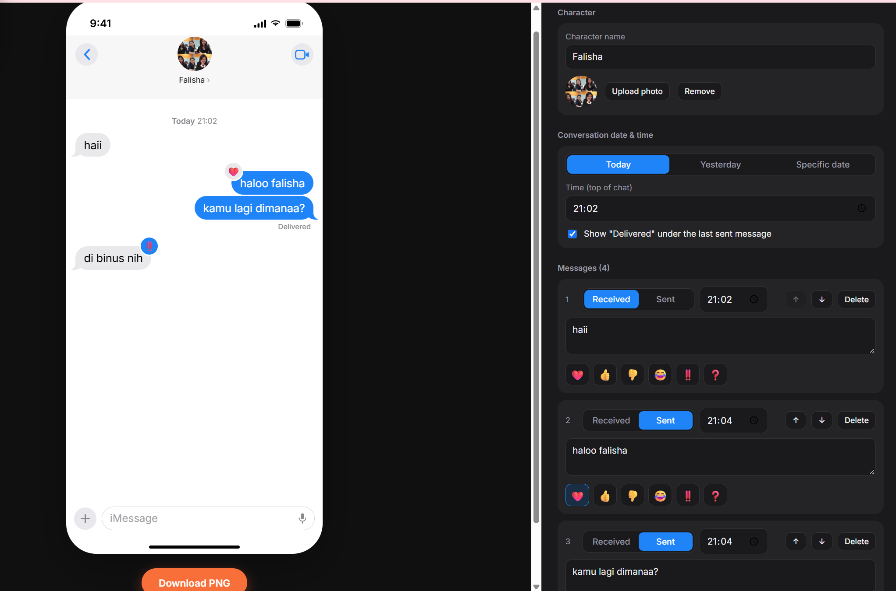
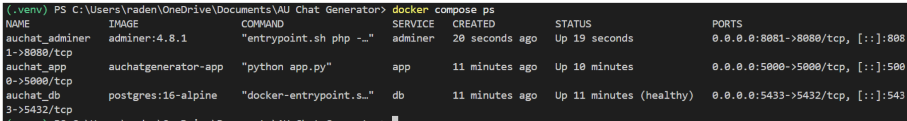
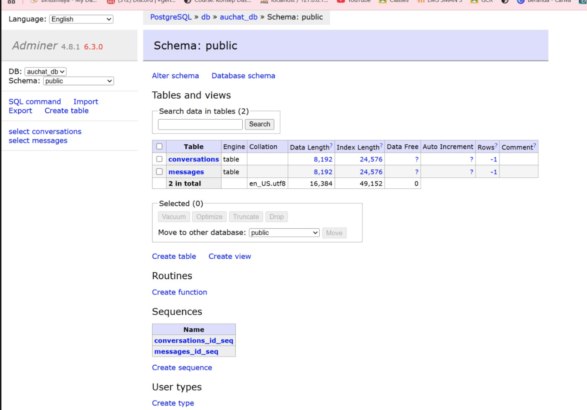
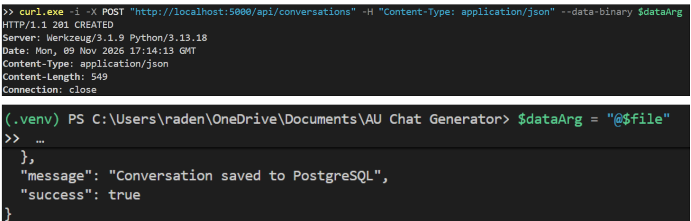

# AU Chat Generator

A web-based fake chat generator designed for Alternative Universe (AU) authors on social media platforms such as TikTok.

## About the Project

AU Chat Generator is a web application that helps authors create fictional conversations using an iOS Messages-style interface.

Creating fake chat screenshots manually can be time-consuming because each chat bubble usually needs to be edited individually using graphic design tools. This project provides a simpler way to create fictional conversations through an interactive editor.

## Main Features

- Customize character name and profile photo.
- Set conversation date and starting time.
- Add multiple chat bubbles.
- Choose Received or Sent message types.
- Customize message timestamps and emoji reactions.
- Insert photos into conversations.
- Preview conversations in real time.
- Download the generated chat as a PNG image.

## Technologies Used

- Python 3.13
- Flask 3.1.1
- PostgreSQL 16
- Flask-SQLAlchemy
- HTML, CSS, and JavaScript
- Docker and Docker Compose
- Adminer

## Application Screenshots

### Main Application


### Docker Containers


### PostgreSQL Database


### API GET


### API POST


## Project Architecture

The application uses a multi-tier architecture consisting of:

1. **Frontend:** HTML, CSS, and JavaScript served through Flask.
2. **Backend:** Flask handles application requests and API endpoints.
3. **Database:** PostgreSQL stores conversations and messages.

All services run in Docker containers connected through a user-defined bridge network. PostgreSQL data is stored using a named volume to maintain persistence.

## How to Run the Project

### Requirements

- Git
- Docker Desktop
- Docker Compose

### Installation

Clone the repository:

```bash
git clone <repository-url>
cd AU-Chat-Generator
```

Create the environment configuration:

```bash
cp .env.example .env
```

Build and start the containers:

```bash
docker compose up -d --build
```

Open the application:

http://localhost:5000

### Optional: Access Adminer

Start Adminer using the tools profile:

```bash
docker compose --profile tools up -d
```

Open:

http://localhost:8081

Use PostgreSQL as the system and `db` as the server.

### Stop the Application

```bash
docker compose down
```

Note: Avoid using `docker compose down -v` when you want to preserve database data.

## API Endpoints

| Method | Endpoint | Description |
|---|---|---|
| GET | /health | Check application and database health |
| GET | /api/conversations | Retrieve conversations |
| GET | /api/conversations/{id} | Retrieve a specific conversation |
| POST | /api/conversations | Save a new conversation |

## Project Links

- **GitHub Repository:** This repository
- **Demo Video:** To be added after publication.
- **Project Article:** To be added after publication.

## AI Usage Declaration

AI tools, including ChatGPT and Claude, were used as development assistants to support code generation, debugging, Docker configuration, and technical explanations.

All generated code and suggestions were reviewed, tested, and adapted during the development process. The final implementation and project testing were carried out by the project author.

## License

This project was developed for academic purposes.
